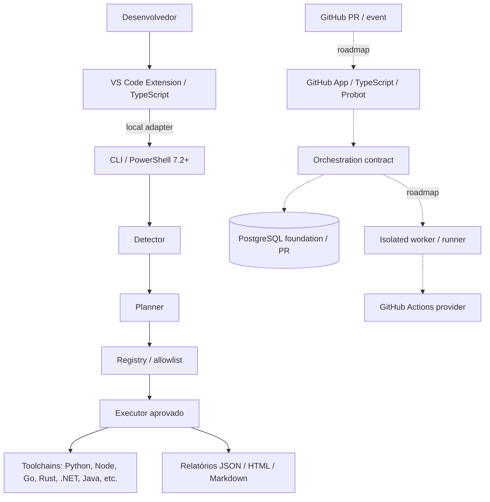
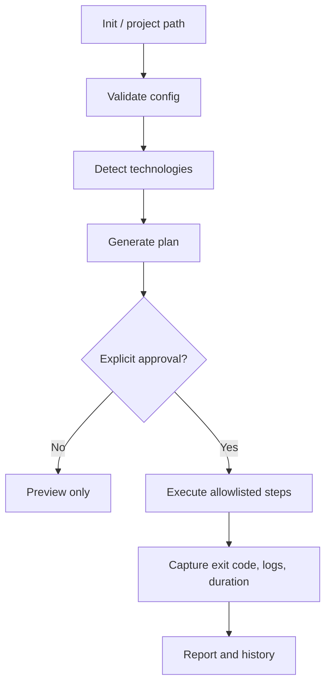
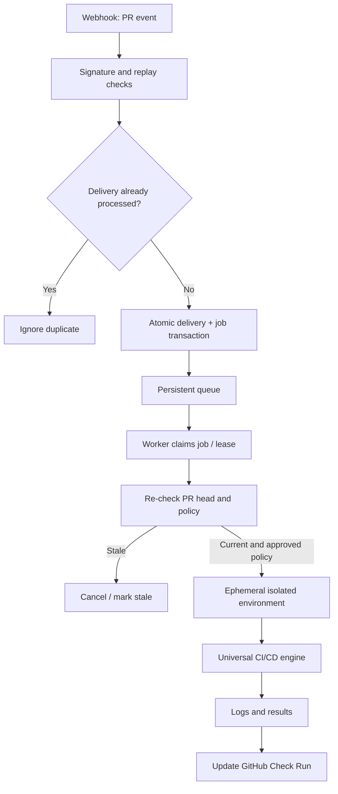

# Diagramas de arquitetura

## Arquitetura lógica (estado atual + componentes planejados)

## Pipeline local

## Orchestration remota futura

**Roadmap diagram:** nodes dashed/not wired imply planned capability; current GitHub App foundation does not execute PR code, dispatch workflows, or create Check Runs.
