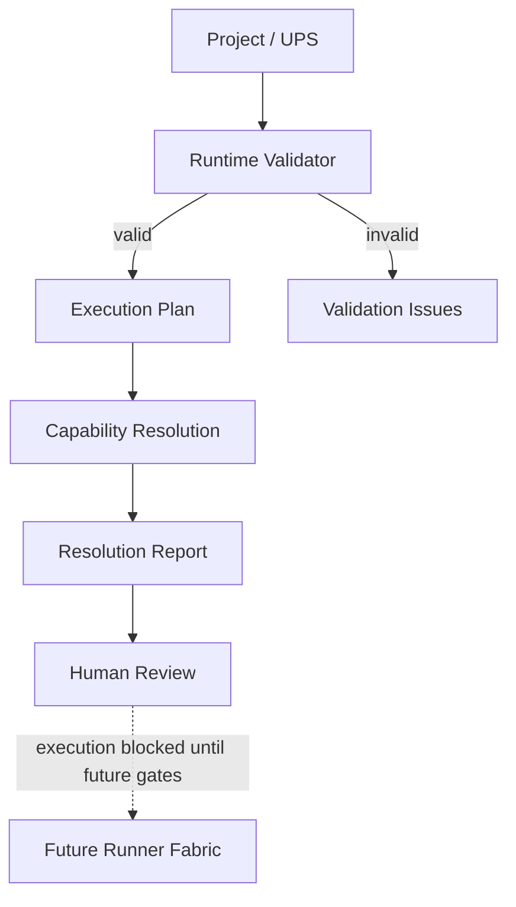

# Universal CI/CD — Architecture Overview

## Architecture layers
1. **Core/PowerShell engine:** discovery, configuration, deterministic analysis and controlled local workflows; existing engine remains source of truth.
2. **Shared contracts (TypeScript):** UPS validation, execution-plan representation and integration contracts; not a replacement engine.
3. **VS Code integration:** user interface, commands, approvals and engine adapter.
4. **GitHub App:** event observation and future checks/orchestration lifecycle; currently bounded by PR-defined scope.
5. **Storage/orchestration foundations:** state, dedupe and PostgreSQL adapter foundations; not a live execution service.
6. **Capability resolution:** pure matching of declared plan requirements against declared inventory; no runner contact.
7. **Future execution fabric:** queue, scheduler, runner protocol, isolation, lifecycle, logs and artifact transport; gated by security design.
8. **Optional intelligence:** diagnostic explanations and proposal generation, subject to privacy, cost and human review.

## Flow (current, plan-only boundary)

## Trust zones
- Developer workstation and workspace.
- GitHub event/API surface.
- Hosted orchestration and persistent storage (future).
- Runner execution environments (future, untrusted code boundary).
- External AI providers (optional, separate consent/data boundary).

## Contracts and invariants
- Validation must precede planning.
- Invalid pipelines do not yield executable plans.
- Execution plans are descriptive, not authorization tokens.
- Capability matches do not grant permission, reserve capacity or contact runners.
- Secrets are not resolved in planning or capability analysis.
- Execution requires explicit future security gates, policy checks, approval, isolation and lifecycle controls.
- Integration boundaries should preserve deterministic tests and avoid implicit network/process side effects.

## Reliability and failure behavior
- Prefer explicit invalid/unknown states over optimistic assumptions.
- Handle stale commit SHA, idempotency and deduplication in orchestration.
- Limit output and time, support cancellation, and avoid shell interpolation.
- Future distributed services must account for retries, idempotency, heartbeat loss, queue starvation, partial failures and recovery.

## Diagram disclaimer
Diagrams represent architecture direction and documented boundaries, not completed production infrastructure.
