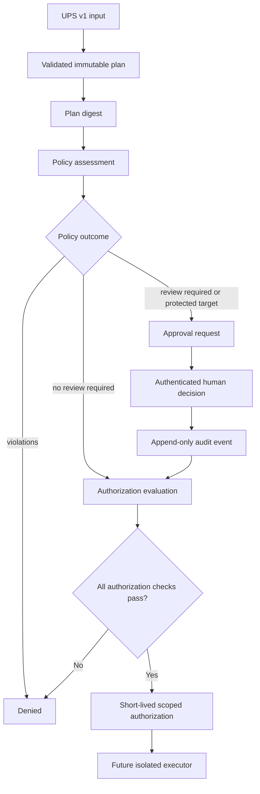

# Execution Authorization & Human Approval Protocol — design v0.1

**Status:** design proposal; not implemented and not an execution control.
**Depends on:** UPS v1 plan, Pipeline Intelligence, Policy & Trust assessment.
**Security posture:** default deny. No runner or command execution is enabled by this document.

## 1. Purpose and separation of responsibilities

The platform must keep four different questions separate:

1. **Plan:** what exact work is proposed?
2. **Policy assessment:** which declared rules match that proposal?
3. **Approval:** which authenticated people reviewed the exact proposal?
4. **Authorization:** does the trusted control plane permit this exact operation now?

A policy result of `compliant` is not approval. An approval is not an execution capability. A stale approval must never authorize a changed plan.

## 2. Proposed flow

The diagram is a target architecture only. The current product does not implement this execution path.

## 3. Approval request — required binding

A future approval request should bind to an immutable canonical payload containing at least:

- request ID and schema version;
- repository identity and installation/tenant identity;
- source ref and exact commit SHA;
- pipeline identifier;
- canonical plan digest and plan schema version;
- policy-set digest and assessment digest;
- target environment and requested runner trust class;
- exact job IDs or an explicit whole-plan scope;
- creation time, expiration time and unique nonce;
- required approval count and separation-of-duties constraints.

Canonical serialization and digest algorithm must be versioned. Any change to the plan, commit, policy, environment, runner trust class or requested scope invalidates prior approvals.

## 4. Human decision record

A decision record should contain:

- approval request ID and exact request digest;
- authenticated principal ID from the identity provider (never a caller-supplied display name);
- decision: approve or reject;
- timestamp assigned by the trusted service;
- optional reason/comment with size limits and safe rendering;
- authentication assurance context and source event ID;
- unique decision ID and idempotency key.

The service, not the browser or extension client, establishes actor identity and timestamps. A client must not be able to submit an approval on behalf of another principal.

## 5. Authorization evaluation — default deny

Before issuing any future execution authorization, a trusted control plane must verify:

1. request is well-formed, current and not expired;
2. request digest still matches the exact plan, commit, policy and target;
3. source commit is still eligible under repository policy;
4. policy assessment is valid and has no blocking findings;
5. every required approval is present, authentic, unique and not revoked;
6. approvers satisfy role, membership, separation-of-duties and quorum rules;
7. no approver is prohibited from self-approving the change;
8. request nonce and approval decisions have not been consumed or replayed;
9. target environment and runner trust class match the approved scope;
10. no revocation, incident hold or policy-version change invalidates the request.

Failure, missing data, unavailable identity provider or ambiguous state means deny, never allow.

## 6. Expiration, revocation and replay

- Approval requests and authorization grants must have short, policy-defined lifetimes.
- Expiration is checked server-side at decision time and immediately before dispatch.
- Revocation must invalidate outstanding grants and pending requests.
- A unique nonce and idempotency key prevent duplicate processing; replayed events are recorded but not re-applied.
- A consumed approval cannot be reused for another run.
- Any change in commit SHA, plan digest, policy digest, environment or job scope requires a new request.
- Clock skew, delayed webhook delivery and out-of-order events require explicit handling.

## 7. Audit model

Use append-only events, not mutable status fields as the only record. Minimum event families:

- request created, updated, expired, cancelled;
- approval granted, rejected, revoked;
- policy assessment attached or superseded;
- authorization denied, issued, expired, revoked, consumed;
- execution dispatch requested, started, completed or failed (future only).

Each event should include a stable event ID, sequence or ordering metadata, server timestamp, actor/service identity, correlation ID, request digest and previous-event linkage or equivalent tamper-evidence. Audit storage must be access-controlled, retained according to a documented policy, and independently exportable. A hash chain alone is not proof against a privileged attacker who can rewrite the entire store; stronger anchoring and access separation are required.

## 8. Trust boundaries and threats

| Threat | Required control |
|---|---|
| Client forges approver identity | Server-side identity-provider verification |
| Approval replay | Nonce, idempotency, single-use consumption |
| Plan changes after approval | Canonical digest binding and reapproval |
| Self-approval / collusion | Separation-of-duties and quorum policy |
| Stale or delayed webhook | Event timestamp, dedupe, state revalidation |
| Revoked membership | Recheck authorization at decision and dispatch |
| Audit tampering | Append-only storage, separated privileges, integrity verification |
| Confused-deputy execution | Scope-bound short-lived grant; executor validates audience and target |
| TOCTOU between approval and dispatch | Revalidate immutable inputs immediately before dispatch |
| Identity provider unavailable | Fail closed |

## 9. Non-goals of this design

This proposal does not:
- authenticate users or implement SSO/OIDC;
- store credentials, secrets or signing keys;
- implement approval UI or approval APIs;
- issue execution tokens;
- authorize or launch commands;
- provision or contact runners;
- claim regulatory compliance or tamper-proof audit.

## 10. Implementation gates

Before code can issue authorization:
- threat model and abuse cases reviewed;
- canonical serialization and digest test vectors specified;
- identity provider and tenant boundary selected;
- role, quorum and separation-of-duties semantics approved;
- transactional state machine and concurrency behavior tested;
- revocation, replay, expiry and TOCTOU adversarial tests pass;
- audit retention, export and tamper-evidence design reviewed;
- isolated runner and credential boundary independently reviewed.

Until all gates are met, the feature remains design-only and all execution paths remain disabled.
