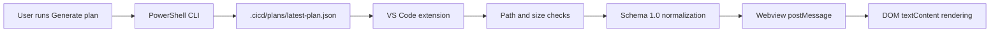

# VS Code Dashboard — Local Plan Inspector

**Status:** baseline implemented in draft PR #19; live file refresh added in draft PR #21, stacked on PR #19.  
**Extension preview:** 0.6.0.  
**Source of truth:** the existing PowerShell engine.

## Data flow

The dashboard reads the latest local plan after the panel opens, after a dashboard command completes, and whenever the watched `.cicd/plans/latest-plan.json` file is created, changed, or deleted while the panel is open. This also covers plans generated externally through the PowerShell CLI. The extension does not regenerate or reinterpret the plan's operational meaning; the PowerShell engine remains responsible for producing it.

## Accepted input

- Exact location: `.cicd/plans/latest-plan.json` under the first active workspace folder.
- Expected schema version: `1.0`.
- Maximum file size: 1 MB.
- Maximum steps: 100.
- Text fields are trimmed and clipped before crossing into the Webview.
- Only a small allowlisted projection is sent: project, generation time, technologies, step ID/name/category/status/reason and derived status counts.
- Unknown statuses map to `UNKNOWN`; malformed plan objects are not rendered.

## Trust and security boundaries

1. Resolve the workspace and plan path to canonical paths.
2. Reject resolved paths outside the workspace.
3. Reject a symlink at the plan file itself and reject oversized/non-regular files.
4. Parse JSON and validate the expected schema before projecting fields.
5. Render all dynamic strings with DOM `textContent`; never treat plan data as HTML.
6. Keep the existing Webview CSP nonce, no remote assets, empty `localResourceRoots`, and command allowlist.

The plan file is workspace data and must be treated as untrusted. The Webview does not receive executable commands from the plan and the message allowlist does not include `run` or `run-workspaces`.

## Current UI behavior

- Shows the latest plan's project, technologies and generation timestamp.
- Summarizes PLANNED, BLOCKED, DISABLED and NOT_APPLICABLE steps.
- Shows each step's name, status and reason.
- Shows an explicit empty state if no valid local plan is available.
- Refreshes the snapshot after a dashboard-triggered command completes.
- Watches the expected plan file for create/change/delete events and updates the open panel without requiring a manual refresh.
- Disposes the watcher and event subscriptions when the panel closes.

## Deliberate limitations

The existing PowerShell plan is a technology-oriented list of steps. It does not currently expose the dependency DAG contract used by the UPS v1 Pipeline Intelligence Engine. Therefore this release does **not** draw dependency edges, parallel waves, or a critical path from the legacy plan. Doing so would fabricate relationships.

A future dashboard iteration can render a true DAG after the VS Code integration can consume a validated UPS v1 execution plan and its analysis result. That work must preserve stable job IDs and explicit dependency edges.

## Validation

- Unit tests cover valid/invalid input, excessive step collections, clipping, and unknown statuses.
- Static Webview tests assert CSP, command allowlist, no remote assets, and text-only rendering.
- CI runs extension typecheck, build/tests, VSIX packaging, and monorepo integration checks.
